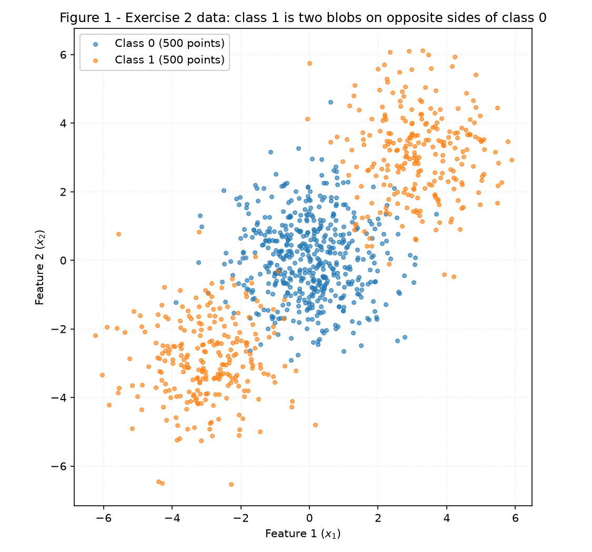
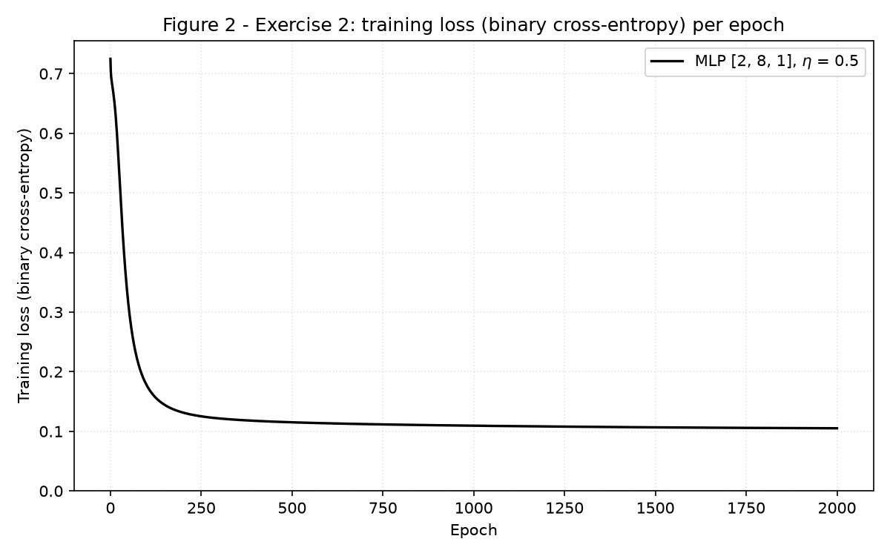
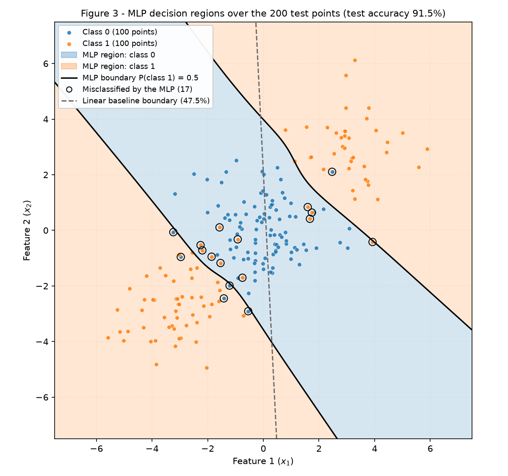
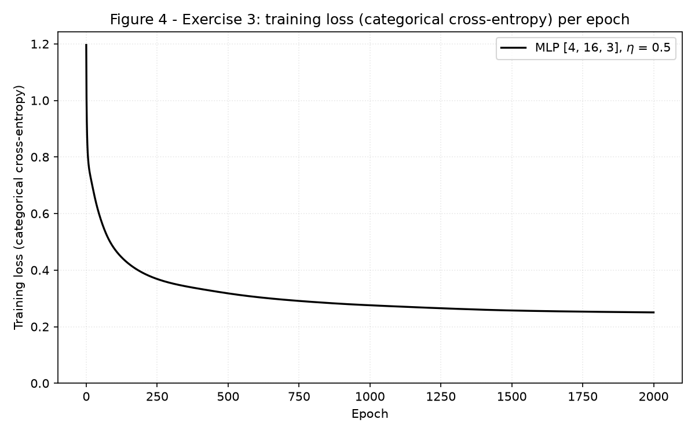
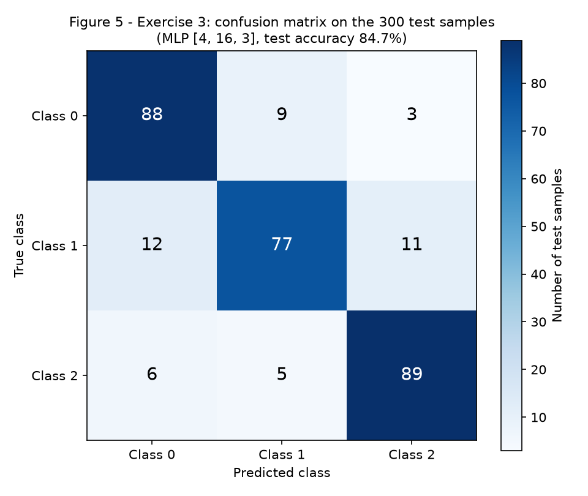
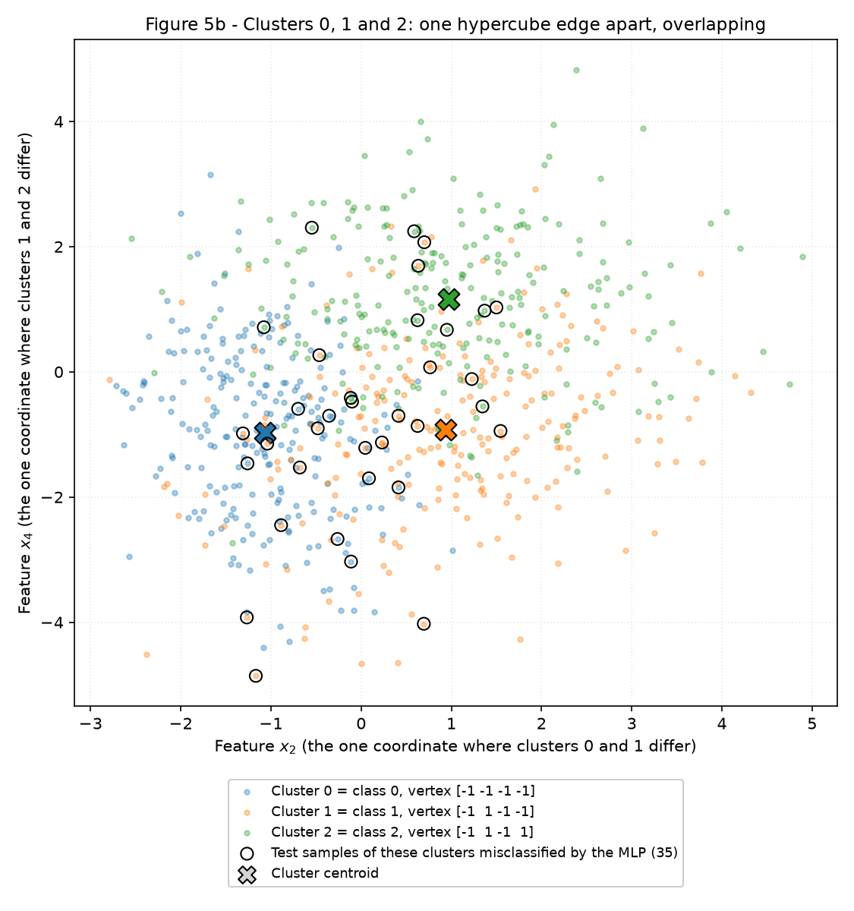
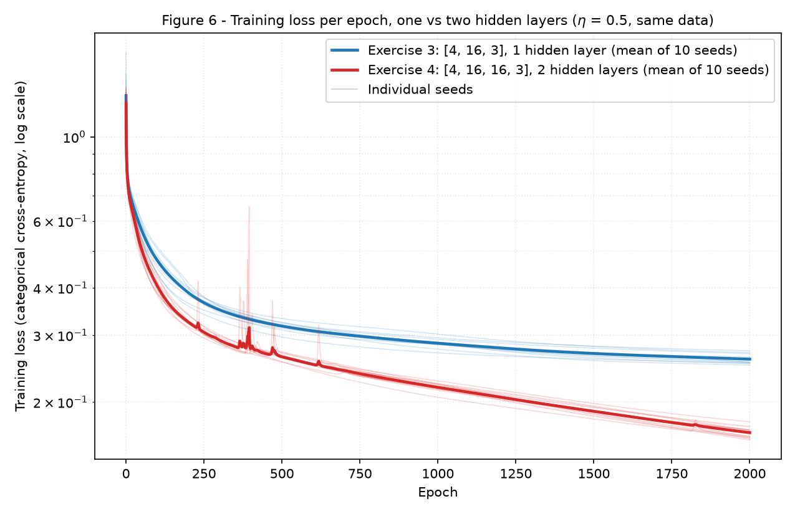

# MLP — Understanding Multi-Layer Perceptrons

**Luca Santana Feltrin** — Insper, ANN & Deep Learning 2026.2

The thread running through this activity is **what a hidden layer buys**. Exercise 1 follows one
gradient step by hand through a 2-2-1 network. Exercise 2 is a dataset where the class-1 region has to
come in two separate pieces, which no straight line can draw. Exercise 3 reuses the same network
unchanged for three classes made of six clusters. Exercise 4 asks whether a second hidden layer buys
anything more. On this data it does not, and the training loss and the test accuracy disagree about
it.

## How to reproduce

Each exercise is a standalone script under [`code/`](https://github.com/LucaFeltrin14/ann-dl/tree/main/docs/exercises/mlp/code),
and all of them import the same network from `mlp.py`. Each script opens with
`rng = np.random.default_rng(42)`, and the weights are drawn from that generator. The datasets use
the statement's `random_state=42`. Every script prints all of its reported values to stdout and
rewrites its figures.

```shell
python3 -m venv .venv && source .venv/bin/activate
python -m pip install -r requirements.txt --upgrade

python docs/exercises/mlp/code/gradient_check.py         # ~1 s: Exercise 1 values and the gradients of mlp.py
python docs/exercises/mlp/code/exercise2_binary.py       # ~1 s
python docs/exercises/mlp/code/exercise3_multiclass.py   # ~2 s
python docs/exercises/mlp/code/exercise4_depth.py        # ~16 s (30 training runs)
```

Libraries used: `numpy` and `matplotlib`. `scikit-learn` is used only where the statement allows it:

- `make_blobs` and `make_classification` generate the data;
- `train_test_split` makes the split;
- `confusion_matrix` builds Figure 5;
- `LogisticRegression` provides the two linear baselines (items 2B and 3D).

**The MLP itself (activations, losses, forward pass, gradients and update) is written by hand in
`mlp.py`.**

## Implementation approach and challenges

The code is split into these files:

- **`mlp.py`** holds the network and nothing else:
    - `sigmoid`, `softmax` and `tanh_derivative` are the activations. The hidden layers use `np.tanh`.
    - `binary_cross_entropy` and `categorical_cross_entropy` are the losses.
    - The `MLP` class takes `layer_sizes` (any number of hidden layers) and `output` (`"sigmoid"` or
      `"softmax"`) as arguments. It has `forward`, `backward` and `update`, plus `fit`, `predict` and
      `accuracy`.
- **`common.py`** holds the seed, the split, the Exercise 3 data and the Exercise 3 training
  settings, which Exercise 4 imports so that the two exercises can only differ in depth.
- **`exercise2_binary.py`**, **`exercise3_multiclass.py`** and **`exercise4_depth.py`** hold one
  script per exercise.
- **`gradient_check.py`** contains checks only. It recomputes Exercise 1 with NumPy and asserts that
  every value typed below matches to 8 decimals. It also compares the gradients of `mlp.py` with
  finite differences of the loss: the largest relative error is \(1.7\times10^{-7}\) over four
  networks, with both output types and one or two hidden layers.

These are the decisions that took some thought, stated here because the results depend on them:

1. **One backward pass for both output types.** Sigmoid with binary cross-entropy and softmax with
   categorical cross-entropy give the *same* derivative at the output,
   \(\partial L/\partial \mathbf{u} = \mathbf{p} - \mathbf{y}\). This is derived in items 2C and 3B.
   `backward` therefore starts from \((\mathbf{P} - \mathbf{Y})/N\) for either type, and Exercise 3
   reuses Exercise 2's forward, backward and update **without changing a line**. Only the
   constructor arguments differ.
2. **Full-batch gradient descent.** Each epoch is one forward pass, one backward pass and one update,
   all on the whole training set. There is no shuffling, so the generator is used only for the
   initial weights. The loss curves are exact and reproducible. The loss of each epoch comes from the
   same forward pass that feeds the gradient, so recording it is free.
3. **Initialization.** The weights are drawn from \(W \sim \mathcal{N}(0, 1/n_{\text{in}})\) and the
   biases start at \(b = 0\). The inputs are used as generated: both datasets are centred with
   spreads of a few units, so the first pre-activations land in the responsive range of tanh rather
   than in its flat tails.
4. **Seeds in Exercise 4.** Item 4B asks for at least 3 seeds, and 10 are used (42–51). The seed only
   changes the initial weights; the data and the split stay those of the statement. Seed 42 is the
   seed of every other run, so the first run of each model *is* the Exercise 3 network and the item-4A
   network. The script asserts this.
5. **The clusters of Exercise 3.** `make_classification` does not return which of its six clusters
   each sample came from, and item 3D is about that structure. Calling it again with `shuffle=False`
   returns the same samples in cluster order, before the final shuffle of rows and columns. Each
   shuffled row is matched to its unshuffled copy through its sorted values, and the script asserts
   that all 1500 match.

## AI collaboration

As declared in this page's front matter, Claude (Anthropic) was used for three things:

- to write the MLP;
- to write the data-generation and check scripts;
- to draft this report, including the Exercise 1 derivation.

Every number below is produced by the committed code and printed by it at run time. The hand values
of Exercise 1 are asserted by `gradient_check.py`. I reviewed the code and the analysis and can
explain every step.

---

## Exercise 1

The network has \(\mathbf{x} \in \mathbb{R}^2\), two tanh hidden units and one tanh output, with the
loss \(L = (y - \hat y)^2\). The given values are:

- \(\mathbf{x} = [0.5, -0.2]\) and \(y = 1\);
- \(\mathbf{W}^{(1)} = \begin{bmatrix} 0.3 & -0.1 \\ 0.2 & 0.4 \end{bmatrix}\) and
  \(\mathbf{b}^{(1)} = [0.1, -0.2]\);
- \(\mathbf{W}^{(2)} = [0.5, -0.3]\) and \(b^{(2)} = 0.2\);
- \(\eta = 0.3\).

The values of \(\tanh\) are computed as \(\tanh(z) = \dfrac{e^{2z} - 1}{e^{2z} + 1}\).

!!! note "Rounding"
    Every number is shown rounded to **8 decimals**. Each step uses the unrounded result of the step
    before it, so adding the terms as displayed can differ from the displayed total in the 8th decimal.

### A — Forward pass

**Hidden pre-activations**, \(\mathbf{z}^{(1)} = \mathbf{W}^{(1)}\mathbf{x} + \mathbf{b}^{(1)}\), one
row of \(\mathbf{W}^{(1)}\) per hidden unit:

\[
\begin{aligned}
z^{(1)}_1 &= 0.3 \cdot 0.5 + (-0.1)(-0.2) + 0.1 = 0.15 + 0.02 + 0.1 = \mathbf{0.27000000} \\
z^{(1)}_2 &= 0.2 \cdot 0.5 + 0.4\,(-0.2) + (-0.2) = 0.10 - 0.08 - 0.20 = \mathbf{-0.18000000}
\end{aligned}
\]

**Hidden activations**, \(\mathbf{h}^{(1)} = \tanh(\mathbf{z}^{(1)})\):

\[
\begin{aligned}
h^{(1)}_1 &= \tanh(0.27) = \frac{e^{0.54} - 1}{e^{0.54} + 1} = \frac{1.71600686 - 1}{1.71600686 + 1}
           = \frac{0.71600686}{2.71600686} = \mathbf{0.26362484} \\
h^{(1)}_2 &= \tanh(-0.18) = \frac{e^{-0.36} - 1}{e^{-0.36} + 1} = \frac{0.69767633 - 1}{0.69767633 + 1}
           = \frac{-0.30232367}{1.69767633} = \mathbf{-0.17808087}
\end{aligned}
\]

**Output pre-activation**, \(u^{(2)} = \mathbf{W}^{(2)}\mathbf{h}^{(1)} + b^{(2)}\):

\[
u^{(2)} = 0.5 \cdot 0.26362484 + (-0.3)(-0.17808087) + 0.2 = 0.13181242 + 0.05342426 + 0.2 = \mathbf{0.38523668}
\]

**Output and loss**:

\[
\hat y = \tanh(0.38523668) = \frac{e^{0.77047336} - 1}{e^{0.77047336} + 1} = \frac{1.16078884}{3.16078884} = \mathbf{0.36724656}
\]

\[
L = (y - \hat y)^2 = (1 - 0.36724656)^2 = 0.63275344^2 = \mathbf{0.40037691}
\]

### B — Backward pass

The loss depends on the parameters through the chain
\(L \leftarrow \hat y \leftarrow u^{(2)} \leftarrow (\mathbf{W}^{(2)}, b^{(2)}, \mathbf{h}^{(1)})\)
and \(\mathbf{h}^{(1)} \leftarrow \mathbf{z}^{(1)} \leftarrow (\mathbf{W}^{(1)}, \mathbf{b}^{(1)})\).
Each gradient below is one more factor of the chain rule.

**1. Loss with respect to the output.** From \(L = (y - \hat y)^2\):

\[
\frac{\partial L}{\partial \hat y} = 2(y - \hat y)\cdot(-1) = -2(y - \hat y) = -2 \cdot 0.63275344 = \mathbf{-1.26550687}
\]

**2. Through the output tanh.** Since \(\hat y = \tanh(u^{(2)})\),
\(\dfrac{\partial \hat y}{\partial u^{(2)}} = 1 - \tanh^2(u^{(2)}) = 1 - \hat y^2 = 1 - 0.13487004 = 0.86512996\). So

\[
\delta^{(2)} \equiv \frac{\partial L}{\partial u^{(2)}} = \frac{\partial L}{\partial \hat y}\,\frac{\partial \hat y}{\partial u^{(2)}}
= -1.26550687 \times 0.86512996 = \mathbf{-1.09482791}
\]

**3. Output layer.** \(u^{(2)} = W^{(2)}_1 h^{(1)}_1 + W^{(2)}_2 h^{(1)}_2 + b^{(2)}\), so
\(\partial u^{(2)}/\partial W^{(2)}_j = h^{(1)}_j\) and \(\partial u^{(2)}/\partial b^{(2)} = 1\):

\[
\frac{\partial L}{\partial \mathbf{W}^{(2)}} = \delta^{(2)}\,\mathbf{h}^{(1)}
= [-1.09482791 \times 0.26362484,\; -1.09482791 \times (-0.17808087)]
= \mathbf{[-0.28862383,\; 0.19496791]}
\]

\[
\frac{\partial L}{\partial b^{(2)}} = \delta^{(2)} \cdot 1 = \mathbf{-1.09482791}
\]

**4. Back into the hidden layer.** \(\partial u^{(2)}/\partial h^{(1)}_j = W^{(2)}_j\), using
\(\mathbf{W}^{(2)}\) *before* the update:

\[
\frac{\partial L}{\partial \mathbf{h}^{(1)}} = \delta^{(2)}\,\mathbf{W}^{(2)}
= [-1.09482791 \times 0.5,\; -1.09482791 \times (-0.3)] = \mathbf{[-0.54741396,\; 0.32844837]}
\]

**5. Through the hidden tanh.** \(\partial h^{(1)}_j / \partial z^{(1)}_j = 1 - (h^{(1)}_j)^2\). With
\((\mathbf{h}^{(1)})^2 = [0.06949805, 0.03171280]\), this factor is \([0.93050195, 0.96828720]\).
Each hidden unit only depends on its own \(z_j\), so the product is element by element:

\[
\boldsymbol\delta^{(1)} \equiv \frac{\partial L}{\partial \mathbf{z}^{(1)}} = \frac{\partial L}{\partial \mathbf{h}^{(1)}} \odot \big(1 - (\mathbf{h}^{(1)})^2\big)
= [-0.54741396 \times 0.93050195,\; 0.32844837 \times 0.96828720] = \mathbf{[-0.50936975,\; 0.31803236]}
\]

**6. Hidden layer.** \(z^{(1)}_i = W^{(1)}_{i1}x_1 + W^{(1)}_{i2}x_2 + b^{(1)}_i\), so
\(\partial z^{(1)}_i / \partial W^{(1)}_{ij} = x_j\) and \(\partial z^{(1)}_i / \partial b^{(1)}_i = 1\).
The weight gradient is the outer product \(\boldsymbol\delta^{(1)}\mathbf{x}^\top\):

\[
\frac{\partial L}{\partial \mathbf{W}^{(1)}} =
\begin{bmatrix} -0.50936975 \times 0.5 & -0.50936975 \times (-0.2) \\ 0.31803236 \times 0.5 & 0.31803236 \times (-0.2) \end{bmatrix}
= \mathbf{\begin{bmatrix} -0.25468488 & 0.10187395 \\ 0.15901618 & -0.06360647 \end{bmatrix}}
\]

\[
\frac{\partial L}{\partial \mathbf{b}^{(1)}} = \boldsymbol\delta^{(1)} = \mathbf{[-0.50936975,\; 0.31803236]}
\]

### C — Parameter update

Each parameter moves by \(\theta \leftarrow \theta - \eta\,\partial L/\partial\theta\), with
\(\eta = 0.3\):

| Parameter | Old | \(-\eta \cdot \partial L/\partial\theta\) | **New** |
|---|---|---|---|
| \(W^{(2)}_1\) | 0.5 | \(-0.3 \times (-0.28862383) = +0.08658715\) | **0.58658715** |
| \(W^{(2)}_2\) | −0.3 | \(-0.3 \times 0.19496791 = -0.05849037\) | **−0.35849037** |
| \(b^{(2)}\) | 0.2 | \(-0.3 \times (-1.09482791) = +0.32844837\) | **0.52844837** |
| \(W^{(1)}_{11}\) | 0.3 | \(-0.3 \times (-0.25468488) = +0.07640546\) | **0.37640546** |
| \(W^{(1)}_{12}\) | −0.1 | \(-0.3 \times 0.10187395 = -0.03056219\) | **−0.13056219** |
| \(W^{(1)}_{21}\) | 0.2 | \(-0.3 \times 0.15901618 = -0.04770485\) | **0.15229515** |
| \(W^{(1)}_{22}\) | 0.4 | \(-0.3 \times (-0.06360647) = +0.01908194\) | **0.41908194** |
| \(b^{(1)}_1\) | 0.1 | \(-0.3 \times (-0.50936975) = +0.15281093\) | **0.25281093** |
| \(b^{(1)}_2\) | −0.2 | \(-0.3 \times 0.31803236 = -0.09540971\) | **−0.29540971** |

The statement counts "eight" parameters, but the network has nine numbers: four in
\(\mathbf{W}^{(1)}\), two in \(\mathbf{b}^{(1)}\), two in \(\mathbf{W}^{(2)}\) and \(b^{(2)}\). All
nine are updated above.

**Would the loss go up or down on a second forward pass? Down.**

*Why, to first order.* Each parameter moves against its own gradient, so the first-order change of
the loss is

\[
\Delta L \approx \sum_\theta \frac{\partial L}{\partial \theta}\,\Delta\theta = -\eta \sum_\theta \Big(\frac{\partial L}{\partial \theta}\Big)^2
= -\eta\,\lVert\nabla L\rVert^2 = -0.3 \times 1.78514110 = -0.53554233 < 0 .
\]

A sum of squares is never negative, so a gradient step always points downhill. Here
\(\lVert\nabla L\rVert^2\) adds the nine squared gradients:
\(0.06486439 + 0.01037830 + 0.02528615 + 0.00404578 + 0.25945754 + 0.10114458 + 0.08330371 + 0.03801248 + 1.19864816\).

- *Intuitively.* \(\hat y = 0.367\) is below the target \(1\), so \(\delta^{(2)} < 0\), and every
  update raises \(u^{(2)}\):
    - \(b^{(2)}\) goes up;
    - \(W^{(2)}_1\) grows, because it multiplies a positive \(h_1\);
    - \(W^{(2)}_2\) becomes more negative, because it multiplies a negative \(h_2\);
    - the hidden units move so that \(h_1\) rises and \(h_2\) falls.
- *First order is not the whole story at \(\eta = 0.3\).* The linear estimate would put the loss at
  \(0.400 - 0.536 < 0\), which a square cannot be: the step is large enough for curvature to matter.
  The direction still holds, as the second forward pass with the new parameters confirms:

\[
\begin{aligned}
\mathbf{z}^{(1)} &= [\,0.18820273 + 0.02611244 + 0.25281093,\;\; 0.07614757 - 0.08381639 - 0.29540971\,] = [0.46712609,\; -0.30307852] \\
\mathbf{h}^{(1)} &= [\tanh(0.46712609),\; \tanh(-0.30307852)] = \Big[\tfrac{2.54530931 - 1}{2.54530931 + 1},\; \tfrac{0.54544296 - 1}{0.54544296 + 1}\Big] = [0.43587433,\; -0.29412735] \\
u^{(2)} &= 0.58658715 \cdot 0.43587433 + (-0.35849037)(-0.29412735) + 0.52844837 = 0.25567828 + 0.10544182 + 0.52844837 = 0.88956848 \\
\hat y &= \tanh(0.88956848) = \tfrac{5.92474092 - 1}{5.92474092 + 1} = 0.71118053, \qquad L = (1 - 0.71118053)^2 = \mathbf{0.08341669}
\end{aligned}
\]

The loss falls from **0.40037691 to 0.08341669**, a 79.2% drop, and \(\hat y\) moves from 0.367 to
0.711, towards the target.

---

## Exercise 2

### A — Generate the data

The data is generated with the statement's call, unchanged:
`make_blobs(n_samples=[500, 250, 250], centers=[[0, 0], [3, 3], [-3, -3]], cluster_std=1.2, random_state=42)`.
Class 0 is the centre blob and class 1 is the two outer blobs, so each class has 500 points. The
80/20 split stratified by `y` gives 800 training and 200 test points.

The split is stratified by *class*, not by *blob*, so the two class-1 blobs are not split evenly:

| Blob | Train | Test |
|---|---|---|
| (0, 0), class 0 | 400 | 100 |
| (3, 3), class 1 | **208** | **42** |
| (−3, −3), class 1 | **192** | **58** |

This imbalance is what pushes the baseline below 50% (item D).


/// caption
**Figure 1** — the 1000 points coloured by class. Class 1 sits on both sides of class 0, along the
diagonal.
///

### B — Establish the baseline

A logistic regression fitted on the training set scores a **test accuracy of 47.50%** (95 of 200),
worse than guessing. Its training accuracy is 52.75%. It learns \(\mathbf{w} = [0.0296, 0.0015]\) and
\(b = -0.0031\), almost no slope at all: the predicted probability of class 1 stays between
**0.4566 and 0.5438** on every test point. Item D explains both numbers.

### C — Implement the MLP

**Architecture.** The network is `MLP([2, 8, 1], output="sigmoid")`:

- 2 inputs;
- one hidden layer of 8 tanh units;
- one sigmoid output, read as \(P(\text{class } 1)\);
- 33 parameters in total.

In principle two hidden units are enough: one soft line on each side of the class-0 band, combined
by the output. Eight leave room for the boundary to bend.

**Forward pass.** For a batch \(\mathbf{X}\) with one sample per row, \(\mathbf{H}^{(0)} = \mathbf{X}\)
and, for each layer \(l = 1, \dots, L\):

\[
\mathbf{U}^{(l)} = \mathbf{H}^{(l-1)}\mathbf{W}^{(l)\top} + \mathbf{b}^{(l)}, \qquad
\mathbf{H}^{(l)} = \tanh(\mathbf{U}^{(l)}) \text{ for hidden layers}, \qquad
\mathbf{P} = \sigma(\mathbf{U}^{(L)}) = \frac{1}{1 + e^{-\mathbf{U}^{(L)}}} .
\]

**Loss.** Binary cross-entropy, averaged over the \(N\) samples:

\[
L = -\frac1N\sum_{i=1}^N \big[\, y_i \log p_i + (1 - y_i)\log(1 - p_i) \,\big].
\]

**Backward pass, derived.** It has two parts.

*The output layer.* For one sample, with \(p = \sigma(u)\):

\[
\frac{\partial L}{\partial p} = -\frac{y}{p} + \frac{1 - y}{1 - p} = \frac{p - y}{p(1 - p)}, \qquad
\frac{\partial p}{\partial u} = \sigma(u)\big(1 - \sigma(u)\big) = p(1 - p)
\quad\Longrightarrow\quad
\frac{\partial L}{\partial u} = p - y .
\]

The \(p(1 - p)\) of the sigmoid cancels the denominator of the cross-entropy. Averaging over the
batch gives \(\boldsymbol\delta^{(L)} = (\mathbf{P} - \mathbf{Y})/N\).

*Every layer.* Write \(\boldsymbol\delta^{(l)} = \partial L / \partial \mathbf{U}^{(l)}\). Since
\(u^{(l)}_{ik} = \sum_j h^{(l-1)}_{ij} W^{(l)}_{kj} + b^{(l)}_k\), the gradients are

\[
\frac{\partial L}{\partial \mathbf{W}^{(l)}} = \boldsymbol\delta^{(l)\top}\mathbf{H}^{(l-1)}, \qquad
\frac{\partial L}{\partial \mathbf{b}^{(l)}} = \sum_{i=1}^N \boldsymbol\delta^{(l)}_i, \qquad
\boldsymbol\delta^{(l-1)} = \big(\boldsymbol\delta^{(l)}\mathbf{W}^{(l)}\big) \odot \big(1 - (\mathbf{H}^{(l-1)})^2\big).
\]

The first two follow from \(\partial u_{ik}/\partial W_{kj} = h_{ij}\) and
\(\partial u_{ik}/\partial b_k = 1\), summed over the samples. The third follows from
\(\partial u_{ik}/\partial h_{ij} = W_{kj}\) and the tanh derivative. These are exactly the steps of
Exercise 1 (items 3–6), written for a whole batch and any number of layers, and they are the code of
`MLP.backward`.

**Update.** For every layer, \(\mathbf{W}^{(l)} \leftarrow \mathbf{W}^{(l)} - \eta\,\partial L/\partial \mathbf{W}^{(l)}\)
and \(\mathbf{b}^{(l)} \leftarrow \mathbf{b}^{(l)} - \eta\,\partial L/\partial \mathbf{b}^{(l)}\).

**Training.**

- Hyperparameters: \(\eta = 0.5\), **2000 epochs** of full-batch gradient descent.
- Initialization: \(W \sim \mathcal N(0, 1/n_{\text{in}})\) and \(b = 0\), drawn from
  `default_rng(42)`.
- Training loss: 0.7248 at epoch 0, 0.1771 at epoch 100, 0.1151 at epoch 500 and **0.1051** at
  epoch 2000.

| Quantity | Value |
|---|---|
| Architecture | **[2, 8, 1]**: tanh hidden layer, sigmoid output, binary cross-entropy (33 parameters) |
| Learning rate, epochs | **0.5**, **2000** (full batch) |
| Train accuracy | 96.75% |
| **Test accuracy** | **91.50%** (183 of 200) |


/// caption
**Figure 2** — training loss (binary cross-entropy) per epoch. Epoch 0 is the initial weights.
///


/// caption
**Figure 3** — the MLP evaluated on a 601 × 601 grid. The shading shows the class each region is
assigned to and the black line is \(P(\text{class } 1) = 0.5\). The 200 test points are drawn on top
and the 17 the MLP misclassifies are circled. The dashed line is the logistic-regression baseline.
///

```python title="mlp.py"
--8<-- "docs/exercises/mlp/code/mlp.py"
```

```python title="common.py"
--8<-- "docs/exercises/mlp/code/common.py"
```

```python title="exercise2_binary.py"
--8<-- "docs/exercises/mlp/code/exercise2_binary.py"
```

### D — Analysis

**The region the MLP assigns to class 1 (Figure 3)** is **two disconnected pieces**:

- the pieces lie in the upper right and the lower left;
- a band of class 0 runs along the anti-diagonal between them;
- walking along the diagonal through the three centres, the prediction switches at
  \(t = -2.276\) and \(t = +2.331\) from the origin, so the band is 4.61 wide;
- along the anti-diagonal, the network predicts class 0 everywhere (0% class 1).

For reference, the best possible boundary for these Gaussians is the pair of lines at
\(t = \pm 2.357\), with an expected accuracy of 94.62%. The network found it almost exactly. Its 17
test errors are points that fell on the wrong side of an overlap, such as class-1 points inside the
band. They are not a flaw in the shape of the region.

**Why no single straight line can produce that region.** A line splits the plane into two
half-planes, so a linear classifier's class-1 region is a half-plane \(\{\mathbf{w}\cdot\mathbf{x} + b > 0\}\),
and a half-plane is **convex**. Convexity is what rules it out:

- any convex set that contains the centre of the blob at \((3, 3)\) and the centre of the blob at
  \((-3, -3)\) must contain the whole segment between them;
- that segment passes through \((0, 0)\), the centre of class 0;
- the class-1 region a correct classifier needs contains both blob centres but not \((0, 0)\)
  (the MLP predicts class 0 there), so it is not convex, and no single line can draw it.

The best any line can do is to give up one outer blob completely, for about 75% at most.

**Why the baseline does even worse, below 50%.** It has two causes.

1. *Logistic regression does not even look for that 75% line.* It minimises cross-entropy, not
   errors, and this data is symmetric: both classes have their mean at the origin. The training means
   are \((0.02, 0.05)\) for class 0 and \((0.21, 0.20)\) for class 1. A linear score
   \(\mathbf{w}\cdot\mathbf{x} + b\) can only reward a direction in which one class sits higher on
   average, and here there is none. Tilting the line towards one outer blob costs as much
   cross-entropy on the opposite blob as it gains. The fit therefore stays flat:
   \(\lVert\mathbf{w}\rVert = 0.0297\), and every predicted probability lies between 0.4566 and
   0.5438.
2. *The small slope that is left comes from a sample imbalance, and that imbalance is reversed in the
   test set.*
    - The blob at \((3, 3)\) received 208 training points against 192 for \((-3, -3)\), which pulls
      the class-1 mean slightly towards \((3, 3)\).
    - The fitted line is nearly vertical, at \(x_1 \approx 0.10\) (the dashed line in Figure 3), and
      it predicts class 1 to its right.
    - On the test set, the line classifies **all** 42 points of blob \((3, 3)\) correctly, **none** of
      the 58 points of blob \((-3, -3)\), and 53 of the 100 centre points: \((42 + 0 + 53)/200 = 47.5\%\).
    - Each blob has exactly 250 points, so the blob that is over-represented in training is
      necessarily under-represented in the test set: \(250 - 208 = 42 < 58\). The line favours the
      blob that the test set has fewer of.
    - On the generating distribution itself, the same line would score 51.68%. The drop to 47.5% is
      that train/test complement.

**What the hidden layer adds.** Each of the 8 hidden units computes a soft line,
\(\tanh(\mathbf{w}_j\cdot\mathbf{x} + b_j)\). The output layer combines them, and a combination of
lines can describe a **non-convex** region: here, everything outside a band. That one capability is
the difference between 47.5% and 91.5%.

---

## Exercise 3

### A — Generate the data

The data is generated with the statement's call, unchanged:
`make_classification(n_samples=1500, n_features=4, n_informative=4, n_redundant=0, n_repeated=0, n_classes=3, n_clusters_per_class=2, class_sep=1.0, random_state=42)`.

- The classes have 499, 499 and 502 samples, not exactly 500 each. The generator flips 1% of the
  labels at random by default (`flip_y=0.01`), which changed 11 labels.
- The 80/20 split, stratified with the same seed, gives 1200 training samples (399/399/402) and 300
  test samples (100/100/100).

### B — Adapt the network

The network is the **same `MLP` class, imported from the same `mlp.py`**. Only the constructor
arguments change:

```python
model = MLP([2, 8, 1], output="sigmoid", rng=rng)    # Exercise 2: 1 output, sigmoid + binary cross-entropy
model = MLP([4, 16, 3], output="softmax", rng=rng)   # Exercise 3: 3 outputs, softmax + categorical cross-entropy
```

With three output units, softmax turns the three scores into probabilities and categorical
cross-entropy replaces binary cross-entropy:

\[
p_k = \frac{e^{u_k}}{\sum_{j=1}^3 e^{u_j}}, \qquad L = -\sum_{k=1}^3 y_k \log p_k
\quad (\mathbf{y} \text{ one-hot}).
\]

**Deriving \(\partial L/\partial \mathbf{u}\).** The derivative of the softmax couples every output
with every score:

\[
\frac{\partial p_k}{\partial u_j} = \frac{e^{u_k}\,[k = j]\,\sum_m e^{u_m} - e^{u_k}e^{u_j}}{\big(\sum_m e^{u_m}\big)^2}
= p_k\big([k = j] - p_j\big).
\]

The chain rule through the loss then gives

\[
\frac{\partial L}{\partial u_j} = -\sum_k \frac{y_k}{p_k}\,\frac{\partial p_k}{\partial u_j}
= -\sum_k y_k\big([k = j] - p_j\big) = -y_j + p_j \sum_k y_k = \boxed{\,p_j - y_j\,},
\]

because a one-hot \(\mathbf{y}\) sums to 1.

**Why it is so simple.** The logarithm of the loss undoes the exponential of the softmax. If \(c\) is
the true class, \(\log p_c = u_c - \log\sum_j e^{u_j}\), so

\[
L = -u_c + \log\sum_j e^{u_j}, \qquad \frac{\partial L}{\partial u_j} = -[j = c] + \frac{e^{u_j}}{\sum_m e^{u_m}} = p_j - y_j .
\]

The loss is linear in the true class's score, plus a log-sum-exp whose gradient is the softmax
itself. Sigmoid with binary cross-entropy is the two-class case of the same pairing, and it gave the
same \(p - y\) in item 2C.

**Verbatim reuse (extra point).** Because both pairs give \(\boldsymbol\delta^{(L)} = (\mathbf{P} - \mathbf{Y})/N\),
`MLP.forward`, `MLP.backward` and `MLP.update` serve Exercise 3 **untouched**. Three things are
arguments, not code: the output size (`3`), the output activation and its loss (`output="softmax"`),
and the hyperparameters. In the git history, `mlp.py` is committed once, before Exercise 2, and is
never modified by the Exercise 3 or Exercise 4 commits. `gradient_check.py` confirms the gradients of
the softmax network against finite differences.

### C — Train and evaluate

**Architecture and hyperparameters.**

- The network is `MLP([4, 16, 3], output="softmax")`: 4 inputs, one hidden layer of 16 tanh units and
  3 softmax outputs, with categorical cross-entropy (131 parameters).
- Training uses \(\eta = 0.5\) and **2000 epochs** of full-batch gradient descent, with the same
  initialization rule and seed as Exercise 2.
- The training loss falls from 1.1963 at epoch 0 to 0.4745 at epoch 100, 0.3177 at epoch 500 and
  **0.2504** at epoch 2000.

| Quantity | Value |
|---|---|
| Architecture | **[4, 16, 3]**: tanh hidden layer, softmax output, categorical cross-entropy (131 parameters) |
| Learning rate, epochs | **0.5**, **2000** (full batch) |
| Train accuracy | 91.50% |
| **Test accuracy** | **84.67%** (254 of 300) |


/// caption
**Figure 4** — training loss (categorical cross-entropy) per epoch. Epoch 0 is the initial weights.
///


/// caption
**Figure 5** — confusion matrix on the 300 test samples (100 per class). Rows are the true class and
columns the predicted class.
///

```python title="exercise3_multiclass.py"
--8<-- "docs/exercises/mlp/code/exercise3_multiclass.py"
```

### D — Analysis

**The most confused pair is classes 0 and 1.** The network mixes them up on **21** test samples: 9
samples of class 0 are predicted as 1 and 12 samples of class 1 as 0. The other pairs are less
confused: 16 for classes 1 and 2, and 9 for classes 0 and 2. Class 1 has the lowest recall, 77%,
against 88% and 89% for the other two classes.

**The cluster structure.** `make_classification` builds the data in four steps:

1. It places the 6 clusters, 2 per class, on 6 of the 16 vertices of a 4-dimensional hypercube with
   side \(2 \times \texttt{class\_sep} = 2\), so every coordinate of a centre is \(\pm1\).
2. It draws each cluster as a standard normal sample multiplied by its own random \(4\times4\)
   matrix, which gives every cluster a different, elongated shape.
3. It flips 1% of the labels.
4. It shuffles the rows and the columns.

After recovering each sample's cluster (decision 5 above), the recovered centroids sit at \(\pm1\) as
expected:

| Cluster | Class | Vertex | Spread (std along its principal axes) | Test samples correct |
|---|---|---|---|---|
| 0 | 0 | \((-,-,-,-)\) | 1.90, 1.47, 0.68, 0.46 | 86.3% |
| 1 | **1** | \((-,+,-,-)\) | **1.74, 1.67, 1.05, 0.67** | **61.2%** |
| 2 | 2 | \((-,+,-,+)\) | 1.90, 1.28, 0.80, 0.32 | 80.4% |
| 3 | 0 | \((+,-,+,+)\) | 1.70, 1.58, 0.83, 0.15 | 89.8% |
| 4 | 1 | \((-,+,+,+)\) | 1.35, 1.10, 0.48, **0.07** | 95.9% |
| 5 | 2 | \((+,+,+,-)\) | 1.97, 1.26, 0.59, 0.43 | 92.9% |

Two clusters on *adjacent* vertices differ in a single coordinate, so their centres are only 2
apart. Along the line joining them, each cluster spreads with a standard deviation of 0.9 to 1.4, so
the two overlap heavily. Exactly three adjacent pairs belong to different classes:

| Adjacent pair | Classes | Distance | Std along the joining line |
|---|---|---|---|
| clusters 0 – 1 | **0 / 1** | 2.032 (differ in \(x_2\)) | 0.875 / 1.192 |
| clusters 1 – 2 | 1 / 2 | 2.082 (differ in \(x_4\)) | 1.367 / 1.121 |
| clusters 2 – 4 | 2 / 1 | 1.917 (differ in \(x_3\)) | 0.948 / 1.081 |

This structure explains the confusion matrix:

- **No class-0 cluster touches a class-2 cluster.** That is why 0↔2 is the least confused pair, with
  9 samples.
- **Cluster 1 is a hinge.** It is the class-1 cluster adjacent to *both* a class-0 cluster
  (cluster 0) and a class-2 cluster (cluster 2), and it is the most spread-out cluster of all.
  Figure 5b shows it squeezed between the two. Only 61.2% of its test samples are classified
  correctly: 11 go to class 0 and 8 to class 2. Its leak towards cluster 0 is most of what keeps the
  recall of class 1 at 77%.
- **The 0↔1 confusion is the overlap between clusters 0 and 1.** Of the 21 confused test samples,
  **18** come from those two clusters: 11 from cluster 1 and 7 from cluster 0. The remaining 3 come
  from clusters 2 and 3.
- **Why 0↔1 and not 1↔2.** Classes 1 and 2 have two adjacencies, but the second one (clusters
  2 – 4) barely overlaps. Cluster 4 is almost flat, with its smallest spread at 0.07, and 95.9% of its
  samples are classified correctly.


/// caption
**Figure 5b** — clusters 0, 1 and 2 in the two coordinates where they differ: \(x_2\) separates
clusters 0 and 1, and \(x_4\) separates clusters 1 and 2. Crosses mark the centroids. The circled
points are the 35 test samples of these clusters that the MLP misclassifies. They fall where the
clouds overlap.
///

**How much of this the network could avoid.** As a reference, an "oracle" knows the cluster of every
training sample, which the network is never told. It fits one Gaussian per cluster and predicts the
class whose two clusters make each test sample most likely. The oracle scores 89.33%, and it still
confuses 12 test samples between classes 0 and 1 and 13 between classes 1 and 2:

- that part of the overlap is in the data, not in the network;
- the 2 test samples whose labels were flipped by the generator cannot be predicted by anyone;
- the network's errors beyond the oracle's fall mostly on 0↔1: 21 against 12;
- the ranking is stable across initializations: over the 10 seeds of Exercise 4, 0↔1 is the most
  confused pair in 8 of 10 runs of this architecture and in 9 of 10 runs of the deeper one.

**The logistic-regression baseline and what the hidden layer added.**

| Model | Test accuracy |
|---|---|
| Logistic regression (multinomial) | **66.33%** (train 63.67%) |
| MLP [4, 16, 3] | **84.67%** (+18.33 points) |

A linear model gives each class one linear score and predicts the largest. The region it assigns to
a class is therefore an intersection of half-spaces, which is **convex**. Each class here is two
clusters at different vertices, and the segment between them runs close to clusters of other
classes:

| Class | Its clusters | Distance from the midpoint to its own centroids | To the nearest other-class centroid |
|---|---|---|---|
| 0 | 0 and 3 | 1.711 | 2.631 (cluster 1) |
| 1 | 1 and 4 | 1.327 | **1.499** (cluster 2) |
| 2 | 2 and 5 | 1.772 | **1.608** (cluster 1): closer than its own |

A convex region that covers both clusters of class 2 must also cover much of cluster 1, and the
reverse holds too. The baseline therefore has to give up whole clusters. It classifies correctly only
**41.3%** of cluster 2's test samples, 51.0% of cluster 1's and 65.3% of cluster 4's. Class 0, whose
segment stays far from the other clusters, keeps about 80% on both of its clusters.

The hidden layer removes the convexity constraint. The tanh units carve out a separate region around
each cluster, and the output layer then assigns both regions to the same class. The gains come
exactly where the baseline was trapped:

- cluster 2: 41.3% → **80.4%**;
- cluster 4: 65.3% → **95.9%**;
- cluster 5: 76.8% → **92.9%**.

---

## Exercise 4

### A — Train the deeper network

The only change from Exercise 3 is one more hidden layer of the same width. Everything else is held
fixed:

- the data, split and seed (42);
- the initialization rule;
- \(\eta = 0.5\) and 2000 epochs of full-batch gradient descent.

The settings are imported from `common.py`, so they cannot drift.

| Quantity | Value |
|---|---|
| Architecture | **[4, 16, 16, 3]**: two tanh hidden layers, softmax output (403 parameters) |
| Final training loss | 0.1690 |
| Train accuracy | 93.83% |
| **Test accuracy (seed 42)** | **85.67%** |

### B — Compare


/// caption
**Figure 6** — training loss per epoch of the Exercise 3 network (blue, one hidden layer) and the
Exercise 4 network (red, two hidden layers), on the same axes with a log scale. The thin lines are
the 10 seeds and the thick lines their mean.
///

Means over **10 seeds** (42–51), ± the standard deviation across seeds:

| | hidden layers | parameters | final train loss | test accuracy |
|---|---|---|---|---|
| **Exercise 3** [4, 16, 3] | 1 | 131 | **0.2595** ± 0.0078 | **84.63%** ± 1.45% |
| **Exercise 4** [4, 16, 16, 3] | 2 | 403 | **0.1661** ± 0.0058 | **83.93%** ± 1.97% |
| *Control, not asked:* [4, 50, 3] | 1 | 403 | 0.1904 ± 0.0033 | 84.73% ± 0.93% |

The parameter counts work out as follows:

- Exercise 3: \(4\cdot16 + 16 + 16\cdot3 + 3 = 131\).
- Exercise 4 adds \(16\cdot16 + 16 = 272\), for 403.
- The control uses one hidden layer of 50 units, which happens to give the same 403 parameters as the
  deeper network. It separates "more parameters" from "more depth".

Paired by seed, **Exercise 4 minus Exercise 3 is −0.70 percentage points** of test accuracy. The
standard deviation of that difference is 2.88 points and its standard error is 0.96. The deeper
network is better in only **4 of the 10 seeds**.

??? example "Per-seed results"
    | Seed | Ex. 3 test acc. | Ex. 4 test acc. | Control test acc. | Ex. 3 train loss | Ex. 4 train loss |
    |---|---|---|---|---|---|
    | 42 | 84.67% | 85.67% | 84.33% | 0.2504 | 0.1690 |
    | 43 | 83.00% | 85.67% | 85.33% | 0.2542 | 0.1624 |
    | 44 | 86.67% | 83.33% | 85.33% | 0.2730 | 0.1589 |
    | 45 | 82.33% | 82.00% | 85.33% | 0.2534 | 0.1601 |
    | 46 | 82.67% | 87.33% | 85.00% | 0.2682 | 0.1774 |
    | 47 | 85.67% | 83.00% | 83.00% | 0.2628 | 0.1684 |
    | 48 | 84.33% | 83.00% | 86.33% | 0.2543 | 0.1621 |
    | 49 | 86.33% | 81.00% | 84.00% | 0.2557 | 0.1689 |
    | 50 | 85.33% | 86.00% | 85.00% | 0.2700 | 0.1724 |
    | 51 | 85.33% | 82.33% | 83.67% | 0.2527 | 0.1610 |

```python title="exercise4_depth.py"
--8<-- "docs/exercises/mlp/code/exercise4_depth.py"
```

### C — Analysis

**What was measured: the second hidden layer does not help.**

- On average the deeper network is **0.70 points worse** on the test set (83.93% against 84.63%), and
  it wins in only 4 of 10 seeds.
- The difference is smaller than the spread between seeds (1.45 and 1.97 points), and one test sample
  is worth 0.33 points, so "no gain, possibly a small loss" is the honest reading.
- Seed 42 alone would have suggested the opposite: 85.67% against 84.67%, a one-point *win*. That is
  exactly the luck that averaging over seeds is there to remove.

**The training loss and the test accuracy tell different stories.**

| Mean over 10 seeds | Exercise 3 | Exercise 4 |
|---|---|---|
| Final training loss | 0.2595 | **0.1661** |
| Train accuracy | 90.62% | **93.88%** |
| Test accuracy | **84.63%** | 83.93% |
| Test loss | **0.3723** | 0.4878 |
| Train − test accuracy gap | 5.98 points | **9.95 points** |

The deeper network wins everywhere on the training set. Its loss is lower from the very first epochs
(0.4049 against 0.4725 at epoch 100) and ends 36% lower. On the test set it is no better in accuracy
and clearly worse in loss: it is *more confident* and *no more correct*. The extra capacity went
into fitting the training sample, including:

- the overlaps between adjacent clusters;
- the 9 flipped labels in the training set;

and none of it went into structure that carries over to new data.

**Why: the data does not need depth.**

- The data is **6 clusters**, each a single Gaussian blob, and the boundaries that matter are between
  pairs of overlapping blobs. For Gaussians those boundaries are smooth (quadratic) surfaces, with no
  hierarchy or repetition for a second layer to exploit.
- One layer of 16 tanh units already gives each cluster its own region (item 3D).
- What separates the network from the oracle (84.6% against 89.3%) is not capacity. Neither more
  parameters (the 403-parameter control: 84.73%) nor more depth (83.93%) closes that gap.
- The remaining errors are set by the overlap of the clouds (Figure 5b), the flipped labels, and how
  well 1200 samples can pin down six elongated 4-D shapes.

**What depth adds, and what it costs.**

- *Representationally.* A second layer computes features *of* features: it combines the first
  layer's 16 soft hyperplanes into 16 new non-linear features. For a fixed number of units, this can
  carve out far more separate regions than a single layer. That is useful when the boundary is
  compositional, and irrelevant for six blobs.
- *In optimization,* the cost is measurable here:
    - **Instability at the same step size.** With \(\eta = 0.5\), the training loss of the shallow
      network **decreased in every one of the 2000 epochs for all 10 seeds**. The loss of the deeper
      network **went up** in 16 to 812 epochs, depending on the seed, with one-epoch jumps of up to
      ×1.42: these are the spikes of Figure 6. Multiplying two weight matrices makes the loss surface
      sharper, so the same step overshoots where the shallow network's does not.
    - **More dependence on the initial weights.** The test accuracy varies more across seeds:
      ±1.97 against ±1.45 points.
    - **Variance from three times the parameters,** which shows in the 9.95-point train–test gap.
- *Depth against parameter count.* At an equal 403 parameters, the wide one-layer control reaches
  84.73% ± 0.93%. The deeper network loses to it by 0.80 points and wins in only 4 of 10 seeds. Depth
  is not a better way to spend the same parameters on this data.

**What data would make the extra depth pay off.** Depth pays when the decision boundary is
**compositional**, that is, built by reusing simpler pieces, and when there is enough data to fit the
extra parameters. Examples:

- **Parity and high-frequency patterns.** In n-bit parity, a checkerboard, or nested spirals, the
  number of regions grows exponentially. A single layer needs exponentially many units, while a deep
  network can build the pattern by composition.
- **Natural signals.** Images, audio and text have hierarchical features: edges combine into textures,
  textures into parts, and parts into objects.
- **Larger datasets.** With many samples, the variance cost seen here shrinks.

Six Gaussian blobs and 1200 samples have none of these properties, so a second layer is pure cost.

---

## Results summary

| # | Quantity | Value |
|---|---|---|
| 1 | Ex. 1 — \(\mathbf{z}^{(1)}\) and \(\mathbf{h}^{(1)}\) | \(\mathbf{z}^{(1)}\) = **[0.27000000, −0.18000000]**, \(\mathbf{h}^{(1)}\) = **[0.26362484, −0.17808087]** |
| 2 | Ex. 1 — \(u^{(2)}\), \(\hat{y}\) and \(L\) | \(u^{(2)}\) = **0.38523668**, \(\hat y\) = **0.36724656**, \(L\) = **0.40037691** |
| 3 | Ex. 1 — the eight updated parameters | \(\mathbf{W}^{(1)}\) = **[[0.37640546, −0.13056219], [0.15229515, 0.41908194]]**, \(\mathbf{b}^{(1)}\) = **[0.25281093, −0.29540971]**, \(\mathbf{W}^{(2)}\) = **[0.58658715, −0.35849037]**, \(b^{(2)}\) = **0.52844837**; the loss falls to 0.08341669 on a second pass |
| 4 | Ex. 2 — linear baseline test accuracy | **47.50%** (95 of 200) |
| 5 | Ex. 2 — architecture and test accuracy | **[2, 8, 1]** (tanh hidden layer, sigmoid output, binary cross-entropy; \(\eta = 0.5\), 2000 epochs): **91.50%** (183 of 200) |
| 6 | Ex. 3 — architecture and test accuracy | **[4, 16, 3]** (tanh hidden layer, softmax output, categorical cross-entropy; \(\eta = 0.5\), 2000 epochs): **84.67%** (254 of 300) |
| 7 | Ex. 3 — most-confused class pair | **Classes 0 and 1**: 21 of 300 test samples (9 + 12), 18 of them from the adjacent clusters 0 and 1 |
| 8 | Ex. 4 — architecture and test accuracy | **[4, 16, 16, 3]** (same \(\eta\) and epochs): **85.67%** at seed 42; **83.93% ± 1.97%** mean over 10 seeds |
| 9 | Ex. 4 — accuracy difference against Ex. 3 (mean over ≥ 3 seeds) | **−0.70 points** (83.93% against 84.63%, mean over 10 seeds; the deeper network wins in 4 of 10) |
