# EDA — Stroke Prediction

**Luca Santana Feltrin · Eduardo Takei Yaginuma · Gabriel Fernando Missaka Mendes**

Insper · Artificial Neural Networks and Deep Learning · 2026.2

This report asks which demographic and recorded health features are associated with the observed
`stroke` label and how to prepare them for a future neural network classification project. It does
not train a predictive model. All exploratory analyses after the split use training rows only;
test rows are used for split accounting and the required transformation checks.

## 0. Proposal

The team selected **classification** with the public, tabular
[Stroke Prediction Dataset, published by fedesoriano](https://www.kaggle.com/datasets/fedesoriano/stroke-prediction-dataset).
The team confirms instructor approval of this dataset. The team repository is
[LucaFeltrin14/ann-dl](https://github.com/LucaFeltrin14/ann-dl).

The CSV contains **5,110 rows × 12 columns**: an identifier, the target, and **10 predictors
(3 numerical and 7 categorical)**. It meets the minimum of 1,000 instances and five mixed-type
features. The same dataset will be retained for the classification deliverable.

**Motivation:** Mixed demographic and health measurements provide a useful test of neural network
preparation: categorical encodings, different numerical scales, missing measurements and a rare
positive class coexist in a compact dataset. Studying these properties first allows the later
modeling choices to be grounded in evidence.

**First risk:** Only **249/5,110 = 4.87%** of rows have `stroke=1`; accuracy alone
could conceal failure to detect positives. The original sampling frame, measurement timing and
collection protocol are not established by the public description, so clinical generalization
and prospective prediction cannot be claimed from this file.

## 1. Initial inspection

### A. Data dictionary

**Source and unit of observation:** Each row is a patient record in the published CSV, with a
unique `id`. The public description does not establish the hospital, country, collection date,
representative sampling or whether measurements precede the stroke label. This is an analysis
of the recorded label, not evidence of future incident stroke prediction.

**Table 1. Complete data dictionary.** Semantic type takes precedence over storage dtype.

| Column | Meaning | Semantic type / role | Unit or values |
| --- | --- | --- | --- |
| `id` | Record identifier | Identifier; excluded | Arbitrary integer; no measurement unit |
| `gender` | Recorded gender category | Nominal categorical | Female, Male, Other |
| `age` | Recorded age | Continuous numerical | Years; fractional ages retained |
| `hypertension` | Recorded hypertension flag | Binary categorical | 0=no, 1=yes |
| `heart_disease` | Recorded heart disease flag | Binary categorical | 0=no, 1=yes |
| `ever_married` | Whether ever married | Binary categorical | No, Yes |
| `work_type` | Recorded employment category | Nominal categorical | Private, Self-employed, Govt_job, children, Never_worked |
| `Residence_type` | Recorded residence category | Binary categorical | Rural, Urban |
| `avg_glucose_level` | Recorded average glucose measurement | Continuous numerical | Public description does not specify the unit; no conversion assumed |
| `bmi` | Body mass index | Continuous numerical | kg/m²; N/A parsed as missing |
| `smoking_status` | Recorded smoking category | Nominal categorical | formerly smoked, never smoked, smokes, Unknown |
| `stroke` | Recorded stroke occurrence | Binary categorical target | 0=no, 1=yes |

The name `gender` is retained from the source; the single `Other` record is not treated as an error.
The source states that `Unknown` in smoking status means the information was unavailable: it is a
recorded missing-information category, distinct from a literal empty cell. No unsupported unit
or medical plausibility cutoff is inferred for glucose.

### B. Quality

**Table 2. Full-file missingness and training missingness by column.**

| column | missing_count | missing_pct | train_missing_count | train_missing_pct | unique_nonmissing |
| --- | --- | --- | --- | --- | --- |
| id | 0 | 0.000 | 0 | 0.000 | 5110 |
| gender | 0 | 0.000 | 0 | 0.000 | 3 |
| age | 0 | 0.000 | 0 | 0.000 | 104 |
| hypertension | 0 | 0.000 | 0 | 0.000 | 2 |
| heart_disease | 0 | 0.000 | 0 | 0.000 | 2 |
| ever_married | 0 | 0.000 | 0 | 0.000 | 2 |
| work_type | 0 | 0.000 | 0 | 0.000 | 5 |
| Residence_type | 0 | 0.000 | 0 | 0.000 | 2 |
| avg_glucose_level | 0 | 0.000 | 0 | 0.000 | 3979 |
| bmi | 201 | 3.933 | 170 | 4.159 | 418 |
| smoking_status | 0 | 0.000 | 0 | 0.000 | 4 |
| stroke | 0 | 0.000 | 0 | 0.000 | 2 |

The largest missingness is **`bmi`: 201/5,110 = 3.93%** in the full file;
training has **170/4,088 = 4.16%**. Every other column has **0 empty values**.
In the training data, `smoking_status=Unknown` is retained and counted in Table 5.

The full-file audit found **0 identical rows**, **0
duplicates after removing `id`**, **0 repeated IDs**, and **0
constant predictors. Explicit domain checks found **0 ages outside [0,120]**,
**0 nonpositive glucose values**, **0
nonpositive observed BMI values**, **0 invalid binary flags**, and
**0 categorical values outside the documented vocabularies**.
Contextual checks found **0 `children` records aged ≥18**,
**0 ever-married records under 18**, and **9
current-smoker records under 18. These contextual flags warrant source clarification, not automatic deletion.

**Leakage audit and dropped columns:** `id` is dropped because its arbitrary value is not a usable
patient measurement; `stroke` is separated as the target and never enters preprocessing or the
projections. No other predictor directly contains the target, and no numerical predictor pair
has an absolute correlation ≥0.90 (Table 6). Correlation alone cannot rule out temporal leakage:
measurement timing is unknown for every health feature. There is no timestamp for a temporal split;
unique IDs support a record split, but cannot prove that undisclosed repeated patients or related
records do not exist. These limitations remain modeling risks.

The full-file quality inventory and target counts are the required stage-1 audit. They do not fit
imputers, scalers, projections or encoders. The fixed split precedes all data-dependent
preprocessing choices and the training analyses below.

### C. Target

**Table 3. Target distribution and partition accounting.**

| partition | label | count | pct |
| --- | --- | --- | --- |
| full | 0 | 4861 | 95.13 |
| full | 1 | 249 | 4.87 |
| train | 0 | 3889 | 95.13 |
| train | 1 | 199 | 4.87 |
| test | 0 | 972 | 95.11 |
| test | 1 | 50 | 4.89 |

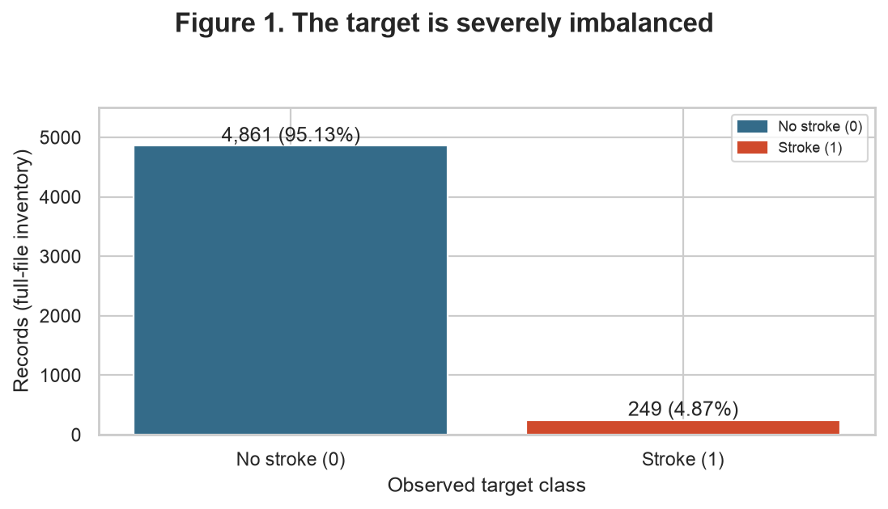

**Conclusion — Figure 1:** The minority class contains 249 records (4.87%), versus 4,861 negatives (95.13%): a 19.52:1 imbalance. An always-negative rule would have 95.13% accuracy but zero positive recall; this is arithmetic, not a trained baseline.

### D. Train and test

Use `train_test_split(..., test_size=0.2, stratify=stroke, random_state=42)`:
**4,088 training records (3,889 negative, 199 positive)** and **1,022 test records (972 negative,
50 positive)**. Both classes appear in both sets; Table 3 gives the resulting percentages.
The IDs are saved in [`results/split_ids.csv`](results/split_ids.csv) and checked for disjointness
and complete coverage of the 5,110 original records. No row was removed before the split.

The absence of dates rules out a defensible temporal split with this file. There are no repeated
IDs to group; if repeated-patient information becomes available, the split must be revisited.
All medians, scales, category vocabularies, outlier fences, correlations and projections below
come from training data. The test set is not used to choose transformations, parameters or figures.
For future model selection, create validation folds within these training IDs and refit the
complete pipeline inside every fold; reserve these test IDs for final evaluation.

## 2. Univariate analysis

### A. Numerical

**Table 4. Descriptive statistics for every numerical predictor; observed training values only.**

| feature | count | mean | std | min | q1 | median | q3 | max | missing | skewness |
| --- | --- | --- | --- | --- | --- | --- | --- | --- | --- | --- |
| age | 4088 | 43.353 | 22.597 | 0.080 | 26.000 | 45.000 | 61.000 | 82.000 | 0 | -0.155 |
| avg_glucose_level | 4088 | 106.317 | 45.260 | 55.120 | 77.312 | 91.945 | 114.198 | 271.740 | 0 | 1.557 |
| bmi | 3918 | 28.922 | 7.928 | 10.300 | 23.600 | 28.000 | 33.100 | 97.600 | 170 | 1.116 |

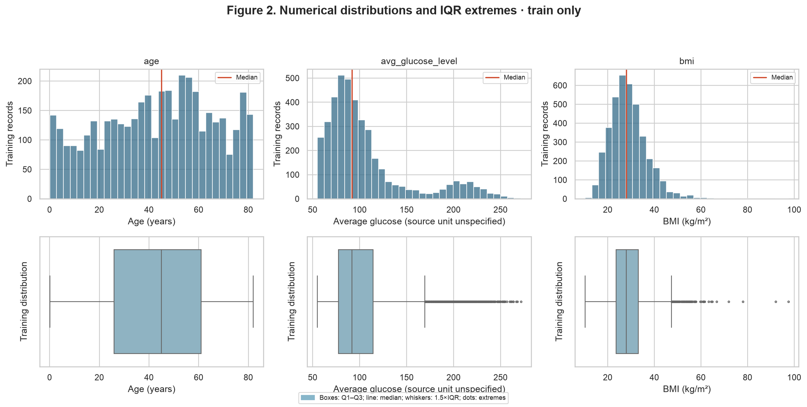

**Conclusion — Figure 2:** Age is broadly spread with weak negative skew (-0.155); glucose and BMI have long right tails (skewness 1.557 and 1.116). The coarse glucose histogram suggests a higher-value shoulder; it does not establish a separate population or formal multimodality. BMI concentrates near its median of 28.00, with extreme observations extending to 97.60.

**Figure choice and interpretation:** One composite figure shows both distribution shape
and IQR extremes for all three features, keeping the item within its three-figure limit.
Age has mean **43.35** and median **45.00**;
glucose has mean **106.32** and median **91.94**;
BMI has mean **28.92** and median **28.00**.
The latter two mean–median gaps support the right-tail reading. Means, medians, standard deviations,
quartiles, extrema and observed counts for every feature are reported in Table 4.
No KDE bandwidth or histogram alone is used to assert the number of modes.

### B. Categorical

**Table 5. Complete category frequencies, cardinalities and rare-category flags, training only.** Rare means less than 1% of training records.

| feature | category | count | pct | cardinality | rare |
| --- | --- | --- | --- | --- | --- |
| gender | Female | 2395 | 58.59 | 3 | False |
| gender | Male | 1692 | 41.39 | 3 | False |
| gender | Other | 1 | 0.02 | 3 | True |
| hypertension | 0 | 3691 | 90.29 | 2 | False |
| hypertension | 1 | 397 | 9.71 | 2 | False |
| heart_disease | 0 | 3867 | 94.59 | 2 | False |
| heart_disease | 1 | 221 | 5.41 | 2 | False |
| ever_married | No | 1388 | 33.95 | 2 | False |
| ever_married | Yes | 2700 | 66.05 | 2 | False |
| work_type | Govt_job | 522 | 12.77 | 5 | False |
| work_type | Never_worked | 13 | 0.32 | 5 | True |
| work_type | Private | 2332 | 57.05 | 5 | False |
| work_type | Self-employed | 667 | 16.32 | 5 | False |
| work_type | children | 554 | 13.55 | 5 | False |
| Residence_type | Rural | 2019 | 49.39 | 2 | False |
| Residence_type | Urban | 2069 | 50.61 | 2 | False |
| smoking_status | Unknown | 1247 | 30.50 | 4 | False |
| smoking_status | formerly smoked | 714 | 17.47 | 4 | False |
| smoking_status | never smoked | 1501 | 36.72 | 4 | False |
| smoking_status | smokes | 626 | 15.31 | 4 | False |

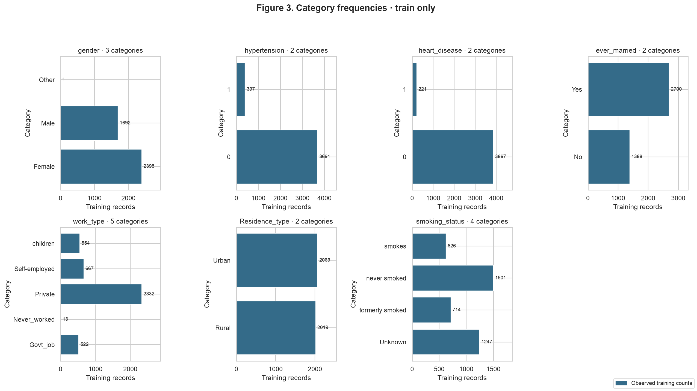

**Conclusion — Figure 3:** Every categorical feature has only two to five observed categories, so none has high cardinality. The frequencies are uneven: binary health flags are dominated by 0, and Private is the largest work category. Rare categories require cautious interpretation and an encoder that tolerates unseen values.

Rare categories (<1%) are **gender=Other: 1 (0.02%); work_type=Never_worked: 13 (0.32%)**. The threshold is a descriptive flag; these categories are not deleted or merged. The ID is high-cardinality (5,110 unique values), but is already excluded. `Unknown` is an information gap, not evidence of nonsmoking. One composite bar-chart figure covers all seven predictors; horizontal labels keep their category names readable.

## 3. Bivariate and multivariate analysis

### A. Numerical × numerical

**Table 6. Pairwise Spearman correlations and complete-pair sample sizes.**

| feature1 | feature2 | n | spearman |
| --- | --- | --- | --- |
| age | avg_glucose_level | 4088 | 0.1409 |
| age | bmi | 3918 | 0.3809 |
| avg_glucose_level | bmi | 3918 | 0.1126 |

Use **Spearman**, because glucose and BMI are asymmetric with extreme observations,
and monotonic associations are more defensible here than an assumption of linear relationships.
Each pair uses the original observed training values; no imputation enters this calculation.
The largest absolute coefficient is **age × bmi:
ρ = 0.3809, n = 3,918**. Using |ρ|≥0.90 as a descriptive
redundancy flag, **zero pairs** are redundant; none is dropped on this basis.

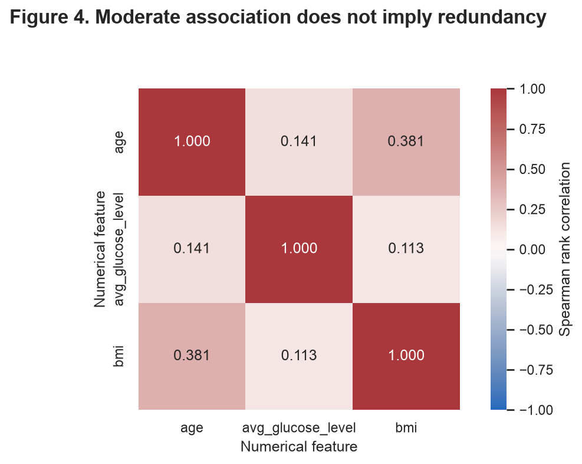

**Conclusion — Figure 4:** The strongest pair is age–BMI (ρ=0.3809), a moderate association rather than interchangeable features. Glucose has weaker monotonic associations with the other numerical features.

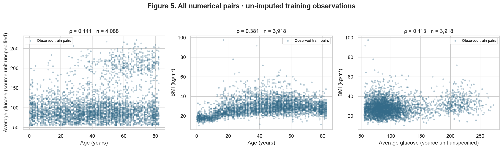

**Conclusion — Figure 5:** The scatters show a broad age–BMI tendency and substantial spread; the glucose upper tail is not described fully by a single coefficient. These two figures were chosen to pair an overview with the underlying observations, rather than infer redundancy from a heatmap alone.

### B. Categorical × target

**Table 7. Stroke counts and conditional proportions for every category (training only).** The denominator is the number of records in that category, not the number of stroke cases.

| feature | category | n | stroke | no_stroke | stroke_pct |
| --- | --- | --- | --- | --- | --- |
| gender | Female | 2395 | 112 | 2283 | 4.68 |
| gender | Male | 1692 | 87 | 1605 | 5.14 |
| gender | Other | 1 | 0 | 1 | 0.00 |
| hypertension | 0 | 3691 | 145 | 3546 | 3.93 |
| hypertension | 1 | 397 | 54 | 343 | 13.60 |
| heart_disease | 0 | 3867 | 163 | 3704 | 4.22 |
| heart_disease | 1 | 221 | 36 | 185 | 16.29 |
| ever_married | No | 1388 | 23 | 1365 | 1.66 |
| ever_married | Yes | 2700 | 176 | 2524 | 6.52 |
| work_type | Govt_job | 522 | 28 | 494 | 5.36 |
| work_type | Never_worked | 13 | 0 | 13 | 0.00 |
| work_type | Private | 2332 | 115 | 2217 | 4.93 |
| work_type | Self-employed | 667 | 55 | 612 | 8.25 |
| work_type | children | 554 | 1 | 553 | 0.18 |
| Residence_type | Rural | 2019 | 91 | 1928 | 4.51 |
| Residence_type | Urban | 2069 | 108 | 1961 | 5.22 |
| smoking_status | Unknown | 1247 | 38 | 1209 | 3.05 |
| smoking_status | formerly smoked | 714 | 56 | 658 | 7.84 |
| smoking_status | never smoked | 1501 | 71 | 1430 | 4.73 |
| smoking_status | smokes | 626 | 34 | 592 | 5.43 |

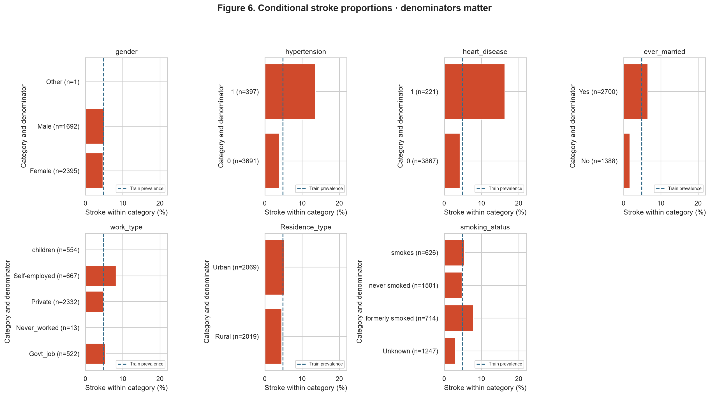

**Conclusion — Figure 6:** Stroke is more frequent in the hypertension=1 group (13.60% (54/397)) than hypertension=0 (3.93% (145/3691)), and in heart_disease=1 (16.29% (36/221)) than heart_disease=0 (4.22% (163/3867)). These are unadjusted associations, not causal effects; age and other confounders may contribute.

The ever-married group has **6.52% (176/2700)**, versus **1.66% (23/1388)**
for never-married records. Self-employed records have **8.25% (55/667)**,
versus **4.93% (115/2332)** for Private; formerly smoked has
**7.84% (56/714)**, versus **4.73% (71/1501)**
for never smoked. Table 7 supplies both classes' counts and all remaining categories, including
residence and gender. A zero rate in a tiny group is not evidence of protection: in particular,
`gender=Other` has only one training record. The complete panel was chosen to expose denominators
and avoid selectively displaying only the largest apparent effects.

### C. Numerical × categorical

The three chosen grouping variables answer different questions: hypertension links recorded disease status to numerical features, work type exposes age structure, and the binary target tests whether class differences concern location, dispersion, or both. Values remain un-imputed; group-specific observed counts, quartiles, medians and IQRs are recorded below.

**Table 8. Hypertension: numerical medians, quartiles and IQRs.**

| feature | group | count | median | q1 | q3 | iqr |
| --- | --- | --- | --- | --- | --- | --- |
| age | 0 | 3691 | 42.00 | 23.00 | 59.00 | 36.00 |
| age | 1 | 397 | 63.00 | 52.00 | 74.00 | 22.00 |
| avg_glucose_level | 0 | 3691 | 91.09 | 77.03 | 112.08 | 35.04 |
| avg_glucose_level | 1 | 397 | 103.89 | 79.79 | 196.01 | 116.22 |
| bmi | 0 | 3560 | 27.70 | 23.30 | 32.70 | 9.40 |
| bmi | 1 | 358 | 31.80 | 27.50 | 36.80 | 9.30 |

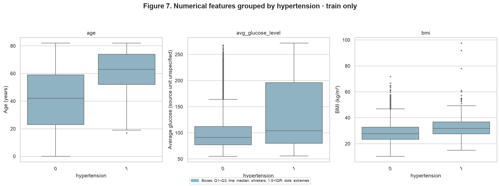

**Conclusion — Figure 7:** Age differs in both location and dispersion: hypertension=0 has median 42.00, IQR 36.00, versus median 63.00, IQR 22.00 for hypertension=1. Glucose has median 91.09, IQR 35.04 versus median 103.89, IQR 116.22; BMI has median 27.70, IQR 9.40 versus median 31.80, IQR 9.30. The glucose boxes differ strongly in spread, while BMI mainly shifts in location; overlap remains.

**Table 9. Work type: numerical medians, quartiles and IQRs.**

| feature | group | count | median | q1 | q3 | iqr |
| --- | --- | --- | --- | --- | --- | --- |
| age | Govt_job | 522 | 51.00 | 41.00 | 62.00 | 21.00 |
| age | Never_worked | 13 | 17.00 | 16.00 | 18.00 | 2.00 |
| age | Private | 2332 | 45.00 | 30.00 | 59.00 | 29.00 |
| age | Self-employed | 667 | 63.00 | 50.00 | 75.00 | 25.00 |
| age | children | 554 | 6.00 | 2.00 | 11.00 | 9.00 |
| avg_glucose_level | Govt_job | 522 | 92.12 | 77.45 | 114.26 | 36.81 |
| avg_glucose_level | Never_worked | 13 | 86.96 | 82.36 | 111.48 | 29.12 |
| avg_glucose_level | Private | 2332 | 92.18 | 77.78 | 114.81 | 37.03 |
| avg_glucose_level | Self-employed | 667 | 92.90 | 76.54 | 124.25 | 47.71 |
| avg_glucose_level | children | 554 | 89.97 | 76.66 | 109.25 | 32.60 |
| bmi | Govt_job | 496 | 29.40 | 25.50 | 34.12 | 8.62 |
| bmi | Never_worked | 13 | 22.70 | 20.80 | 25.90 | 5.10 |
| bmi | Private | 2241 | 29.00 | 25.10 | 34.20 | 9.10 |
| bmi | Self-employed | 628 | 29.30 | 25.68 | 33.70 | 8.03 |
| bmi | children | 540 | 18.90 | 17.20 | 21.32 | 4.12 |

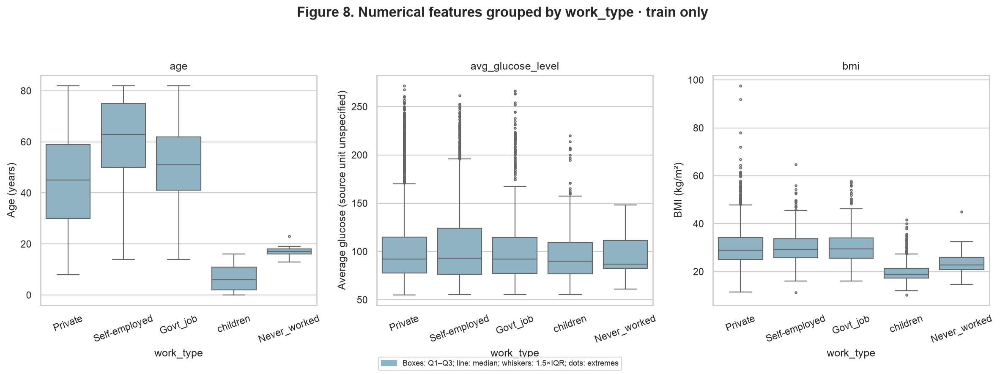

**Conclusion — Figure 8:** Work categories encode different age structures: children has median 6.00, IQR 9.00, Private has median 45.00, IQR 29.00, and Self-employed has median 63.00, IQR 25.00. Location and spread differ together, making age a plausible confounder of the category–stroke association; BMI comparisons also require care because children and adults are mixed.

**Table 10. Target class: numerical medians, quartiles and IQRs.**

| feature | group | count | median | q1 | q3 | iqr |
| --- | --- | --- | --- | --- | --- | --- |
| age | 0 | 3889 | 44.00 | 24.00 | 59.00 | 35.00 |
| age | 1 | 199 | 70.00 | 58.50 | 78.00 | 19.50 |
| avg_glucose_level | 0 | 3889 | 91.65 | 77.28 | 112.98 | 35.70 |
| avg_glucose_level | 1 | 199 | 104.86 | 78.44 | 195.47 | 117.03 |
| bmi | 0 | 3756 | 27.95 | 23.50 | 33.10 | 9.60 |
| bmi | 1 | 162 | 29.90 | 26.52 | 33.70 | 7.17 |

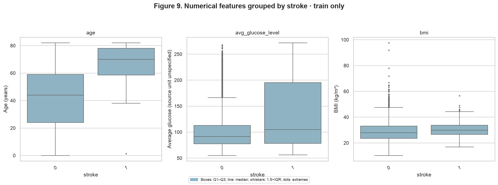

**Conclusion — Figure 9:** Stroke classes differ in age location and spread: class 0 has median 44.00, IQR 35.00, class 1 has median 70.00, IQR 19.50. Glucose class 0 has median 91.65, IQR 35.70, class 1 has median 104.86, IQR 117.03. BMI shows median 27.95, IQR 9.60 versus median 29.90, IQR 7.17, with overlapping distributions and fewer observed positives due to missing BMI.

## 4. Preprocessing

### A. Strategies

These choices prepare the features for a neural network without consuming the test set.

**Missing values:** BMI is the only column with empty cells (Table 2). Training BMI missingness
is **18.59% for stroke=1** versus **3.42% for stroke=0**.
Dropping incomplete rows could disproportionately remove positives. Impute each numerical
feature with its **training median**, and retain an explicit **0/1 BMI-missing indicator** so the
absence is not silently equated to an observed median. This pattern may reflect collection practice,
so the indicator is also a leakage/generalization risk to review in future modeling.
Categorical empty cells, if encountered, use `__MISSING__`; the observed `Unknown` smoking category
is retained separately. No missing value is filled using the target.

**Outliers:** Table 11 applies training-only 1.5×IQR fences to observed values.
There are **569 distinct flagged training rows** (some features can flag the same row).
The chosen strategy **removes 0 rows and clips 0 values**: an IQR flag does not establish an erroneous
health measurement, and adult BMI thresholds should not be imposed on a mixed-age sample.
Retain the extremes and document their influence; do not delete a minority patient because of
an unusual feature. Robust scaling limits the effect of extremes on fitted location and scale,
although it does **not** bound the transformed values or eliminate their effect on PCA.

**Table 11. Training outlier fences and counts.**

| feature | lower_fence | upper_fence | flagged | flagged_pct |
| --- | --- | --- | --- | --- |
| age | -26.500 | 113.500 | 0 | 0.000 |
| avg_glucose_level | 21.985 | 169.525 | 503 | 12.304 |
| bmi | 9.350 | 47.350 | 90 | 2.202 |

**Encoding:** The seven nominal predictors (including hypertension and heart disease) have
2–5 categories each (Table 5), making one-hot encoding appropriate without a large vocabulary.
Use `drop=None`: there is no reference-category constraint for a neural network, and observed
categories remain explicit. `OneHotEncoder(handle_unknown="ignore")` maps an unseen category to
an all-zero block and preserves the feature count. This is explicitly checked using a synthetic
unseen gender; the real test set need not contain an unseen category to test this contract.
Do not target-encode, resample, or balance before the split.

**Scaling:** The training ranges differ: age **0.08–82.00**,
glucose **55.12–271.74**,
and BMI **10.30–97.60** (Table 4), while categorical
indicators lie in [0,1]. The observed glucose/BMI right tails and Table 11 motivate
**RobustScaler**, subtracting the training median and dividing by the training IQR **after
imputation**. It helps numerical conditioning without fitting extreme-sensitive mean/variance
parameters. One-hot columns and the missingness indicator remain 0/1; scaling every rare binary
column to unit variance would amplify rare categories. No additional scaling is fitted on test.

**Table 12. Fitted numerical parameters.** The scaler IQR uses the imputed training matrix;
therefore it can differ from Table 4's observed-value quartiles.

| feature | imputation_median | scaler_center | scaler_iqr |
| --- | --- | --- | --- |
| age | 45.000 | 45.000 | 35.000 |
| avg_glucose_level | 91.945 | 91.945 | 36.885 |
| bmi | 28.000 | 28.000 | 9.000 |

### B. Dimensionality reduction

All projections use the **same 4,088 training rows and 24 pipeline-output features**.
Neither `stroke` nor `id` enters their fitting; target values are used **only for coloring**.
There is no subsampling for fitting. Euclidean distance is applied to robust-scaled numerical
features plus one-hot categories and the BMI-missing indicator. This mixed representation weights
continuous and categorical blocks according to this preprocessing choice; its geometry is not a
clinical distance. Redundant one-hot blocks can also create zero-variance PCA directions.

**PCA:** Fit full SVD on the transformed train only. **PC1 explains 29.25%**,
**PC2 explains 17.40%**, and together they explain
**46.65%**; **10 components** reach 90% cumulative
variance. The two displayed components therefore cannot represent all predictive information.
PCA centers its input internally; no target enters the decomposition.

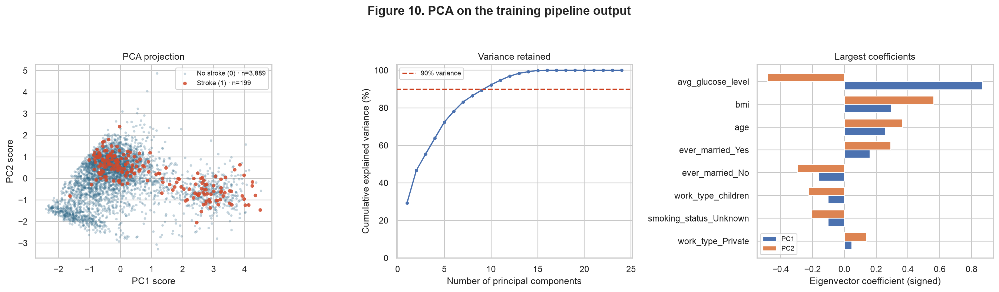

**Conclusion — Figure 10:** The positive records are visually more common toward the higher-glucose arm and the older/higher-BMI portion, but negatives occupy these regions too. PC1 is dominated by glucose (+0.8684); PC2 contrasts BMI (+0.5612) and age (+0.3659) with glucose (-0.4818). The projection preserves only 46.65% of variance and does not demonstrate class separability.

**Table 13. Five largest absolute eigenvector coefficients per displayed component.** Full coefficients are in [`results/pca_loadings.csv`](results/pca_loadings.csv).

| component | feature | coefficient |
| --- | --- | --- |
| PC1 | num__avg_glucose_level | 0.8684 |
| PC1 | num__bmi | 0.2975 |
| PC1 | num__age | 0.2572 |
| PC1 | cat__ever_married_No | -0.1609 |
| PC1 | cat__ever_married_Yes | 0.1609 |
| PC2 | num__bmi | 0.5612 |
| PC2 | num__avg_glucose_level | -0.4818 |
| PC2 | num__age | 0.3659 |
| PC2 | cat__ever_married_No | -0.2923 |
| PC2 | cat__ever_married_Yes | 0.2923 |

**PC1 reading:** The largest contributions are `num__avg_glucose_level` (+0.8684), `num__bmi` (+0.2975), `num__age` (+0.2572). Same-sign coefficients move in the same score direction; opposite signs express a contrast. These are eigenvector coefficients, not correlations or feature importance for stroke prediction. Component signs can be reversed without changing the projection's information.

**PC2 reading:** The largest contributions are `num__bmi` (+0.5612), `num__avg_glucose_level` (-0.4818), `num__age` (+0.3659). Same-sign coefficients move in the same score direction; opposite signs express a contrast. These are eigenvector coefficients, not correlations or feature importance for stroke prediction. Component signs can be reversed without changing the projection's information.

**t-SNE:** Compare perplexities **30 and 50**, with 2 components, Euclidean metric,
PCA initialization, `learning_rate="auto"`, 1,000 iterations, and `random_state=42`.
**UMAP:** Compare `n_neighbors` **15 and 50**, with 2 components, `min_dist=0.1`, Euclidean
metric, spectral initialization, 500 epochs, `random_state=42`, `transform_seed=42` and `n_jobs=1`.
The parameter pairs are sensitivity checks, not an optimization against test labels or target separation.

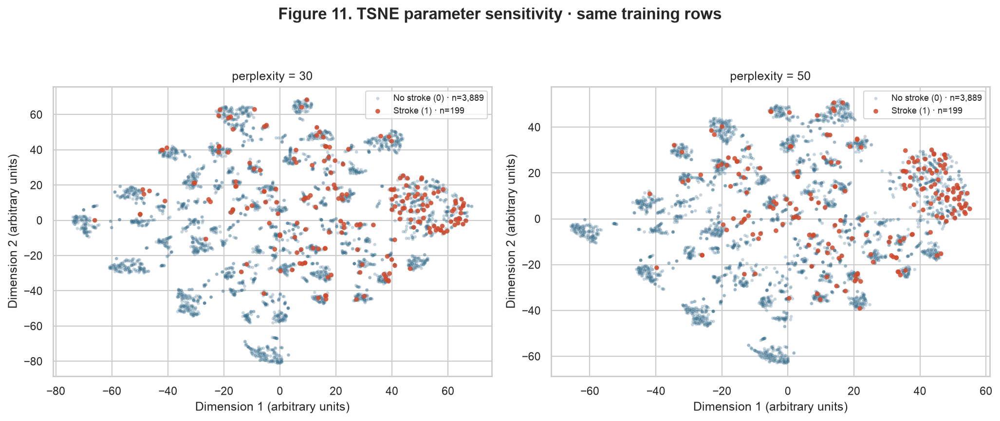

**Conclusion — Figure 11:** Both perplexities show many small local groups and a region containing more visible positives, with negative records mixed into it. A clean class boundary is absent at either setting. Trustworthiness is 0.9730 at perplexity 30 and 0.9769 at 50 (Table 14), exceeding PCA's 0.8257 on the same evaluation subset. Island sizes and inter-island distances do not measure original feature-space distances or disease risk.

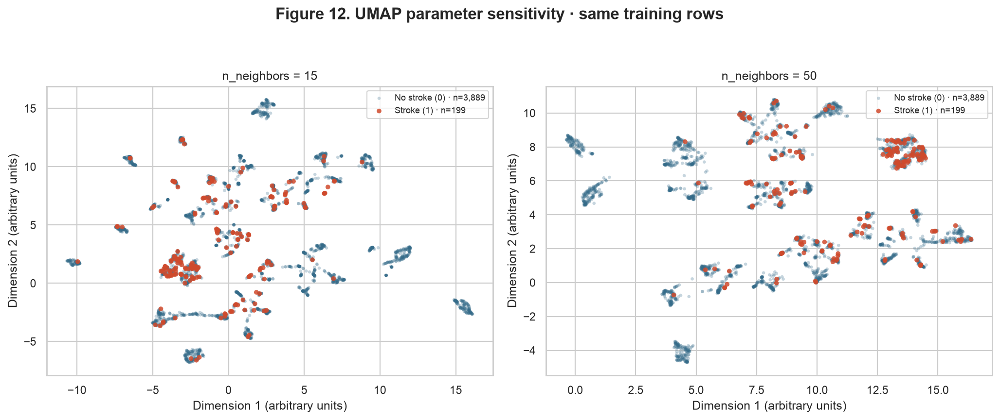

**Conclusion — Figure 12:** Both neighborhood sizes show separated local groups and mixed-class regions; their positions and arrangement change markedly between settings. Trustworthiness is 0.9672 at 15 neighbors and 0.9725 at 50 (Table 14). Local organization is better preserved than in 2D PCA, but this metric does not validate the apparent islands or show that stroke is predictable.

**Table 14. Projection diagnostics.** Trustworthiness (k=10) is evaluated on the same fixed, random 1,000-row subset of training data for all maps; it measures neighborhood preservation within that subset. It is not a classification score. t-SNE KL divergence is an optimization diagnostic; comparing its values across perplexities does not identify a predictive winner.

| method | parameter | trustworthiness | kl_divergence |
| --- | --- | --- | --- |
| pca | 2 | 0.8257 | — |
| tsne | 30 | 0.9730 | 0.8359 |
| tsne | 50 | 0.9769 | 0.8491 |
| umap | 15 | 0.9672 | — |
| umap | 50 | 0.9725 | — |

**Comparison:** PCA supplies a global linear view with interpretable variance and coefficients.
t-SNE and UMAP reveal fragmented local arrangements that can be compressed
or superimposed by the first two principal components. Mixed categorical indicators can contribute
to these fragments, but target coloring alone does not identify which variable generates them. Their island layouts depend on neighborhood
parameters and on the chosen mixed-feature distance. Inspect the two settings together rather than
name a single cluster configuration as ground truth. Figure 10 gives the interpretable variance
baseline; Figures 11–12 show the extra local detail, and Table 14 quantifies neighborhood distortion.
None of these embeddings is used to claim future classifier performance. The pipeline retains the
original transformed features for the later modeling deliverable rather than replacing them with
a chosen 2D embedding.

### C. Pipeline

The importable factory `build_preprocessor()` in [`code/preprocessing.py`](code/preprocessing.py)
returns an unfitted scikit-learn `Pipeline` containing a `ColumnTransformer` with numerical,
BMI-missing-indicator and categorical branches. `eda.py` calls **`fit_transform(X_train)` once**,
and **`transform(X_test)`**. The target is separate; `id` is absent from `FEATURES`.

The final output is **train `(4088, 24)` and test `(1022, 24)`**,
with **0 training NaNs, 0 test NaNs and zero infinities**.
The 24 features are three scaled numerical columns, one missingness indicator and
20 one-hot columns. The exact names are reported below and exported in
[`results/feature_names.csv`](results/feature_names.csv).

**Table 15. Final feature names in output order.**

| feature |
| --- |
| num__age |
| num__avg_glucose_level |
| num__bmi |
| bmi_missing__missingindicator_bmi |
| cat__gender_Female |
| cat__gender_Male |
| cat__gender_Other |
| cat__hypertension_0 |
| cat__hypertension_1 |
| cat__heart_disease_0 |
| cat__heart_disease_1 |
| cat__ever_married_No |
| cat__ever_married_Yes |
| cat__work_type_Govt_job |
| cat__work_type_Never_worked |
| cat__work_type_Private |
| cat__work_type_Self-employed |
| cat__work_type_children |
| cat__Residence_type_Rural |
| cat__Residence_type_Urban |
| cat__smoking_status_Unknown |
| cat__smoking_status_formerly smoked |
| cat__smoking_status_never smoked |
| cat__smoking_status_smokes |

Verification checks that fitting statistics match the training partition, that transformation
leaves the fitted estimator unchanged, and that a deliberately perturbed held-out batch does not
change the training representation. Synthetic inputs with missing numerical values, missing
smoking category and an unseen gender produce finite output with the same width. These checks
are reproducible with `verify.py`; none trains a classifier.

## 5. Synthesis

### Findings and risks for the modeling team

| Finding and evidence | Modeling consequence / handling plan |
| --- | --- |
| Minority class: 249 cases, 4.87% (Table 3; Figure 1) | Use stratified validation within training. Report PR-AUC, recall, precision and confusion counts; choose thresholds using validation. Fit class weights or any resampling inside training folds only. |
| Age structure and unadjusted disease/category associations overlap (Tables 7–10; Figures 6–9) | Keep the features, investigate confounding and subgroup behavior during validation; avoid causal or diagnostic claims from EDA. |
| BMI missingness is more frequent among positives (Table 2; section 4A) | Keep median imputation and the indicator; compare validation behavior with/without the indicator and investigate recording-time leakage. |
| Glucose and BMI have right tails; 569 rows are flagged by IQR (Tables 4 and 11; Figure 2) | Retain the rows, use robust scaling and inspect training-fold sensitivity to extreme values; never select cutoffs from test outcomes. |
| Rare categories and unavailable smoking information (Table 5; Figure 3) | Preserve documented categories; handle new categories explicitly and monitor their frequency. One training record cannot support a gender-specific conclusion. |
| Strongest numerical pair is moderate, not redundant (Table 6; Figures 4–5) | Keep all three numerical predictors; do not turn an exploratory rank correlation into automatic feature selection. |
| PCA loses information and nonlinear maps vary with settings (Figures 10–12; Tables 13–14) | Use projections to inspect geometry, keep the full pipeline features for modeling, and evaluate any later dimension reduction within validation folds. |
| Collection provenance and feature timing are not established (sections 0 and 1) | Treat the task as classification of recorded labels. Obtain provenance and longitudinal timing before claiming future risk prediction or clinical validity. |

### Reproduction, audit and source code

The original CSV is bundled under `code/data/`. SHA-256:

```text
644d473b05d2797006bd94865e4f8bb057f0c721617911613c82c8fcfc707420
```

Run from the repository root with Python 3.11 or 3.12:

```shell
python3 -m venv .venv
source .venv/bin/activate
python -m pip install -r requirements.txt
python docs/projects/eda/code/eda.py
python docs/projects/eda/code/verify.py
mkdocs build --strict
```

The first script regenerates all 12 figures, computed tables, saved coordinates, split IDs,
`results/metrics.json` and this report. It prints fitted dimensions and numerical diagnostics.
`verify.py` recomputes the required statistics independently from the bundled file, checks
preprocessing isolation and tests missing/unseen inputs. See
[`results/metrics.json`](results/metrics.json) for every recorded library version.
The computation was run with **Python 3.11.9**. Numerical reproducibility uses the fixed
seed and pinned numerical packages; embedding coordinates and rendering can still vary across
platforms or numerical-library versions. Projection comparisons use unchanged IDs and parameters.

**Table 16. Numerical environment used for this execution.**

| Package | Version |
| --- | --- |
| matplotlib | 3.11.2 |
| numba | 0.68.0 |
| numpy | 2.4.6 |
| pandas | 3.0.6 |
| scikit-learn | 1.9.1 |
| scipy | 1.17.1 |
| seaborn | 0.13.2 |
| umap-learn | 0.5.12 |

The sources below are pulled in from executable files, as required by the
[submission format](https://insper.github.io/ann-dl/2026.2/exercises/submission/).
The team must be able to explain the split, the BMI missingness pattern, the fitted parameters,
the meaning of the PCA coefficients, and why the nonlinear maps do not measure model quality.

??? example "Importable preprocessing pipeline"

    ```python
    --8<-- "docs/projects/eda/code/preprocessing.py"
    ```

??? example "Analysis and figure generation"

    ```python
    --8<-- "docs/projects/eda/code/eda.py"
    ```

??? example "Independent numerical and pipeline verification"

    ```python
    --8<-- "docs/projects/eda/code/verify.py"
    ```

The report renderer is also an executable file: [`code/report.py`](code/report.py).

**References:** [dataset publisher](https://www.kaggle.com/datasets/fedesoriano/stroke-prediction-dataset),
[project specification and rubric](https://insper.github.io/ann-dl/2026.2/projects/eda/),
[course leakage guidance](https://insper.github.io/ann-dl/2026.2/classes/data/leakage/),
[OneHotEncoder](https://scikit-learn.org/stable/modules/generated/sklearn.preprocessing.OneHotEncoder.html),
[RobustScaler](https://scikit-learn.org/stable/modules/generated/sklearn.preprocessing.RobustScaler.html).

### Results summary

| # | Results summary | Value |
| --- | --- | --- |
| 1 | Dataset, task and target | Stroke Prediction Dataset; classification; `stroke` (0/1) |
| 2 | Instances × features (numerical / categorical) | 5,110 × 10 predictors (3 numerical / 7 categorical); source file has 12 columns including ID and target |
| 3 | Column with the most missing values and its percentage | `bmi`: 201 missing, 3.93% of the source file; 170, 4.16% in training |
| 4 | Dropped columns and the reason | `id`: arbitrary identifier; `stroke`: separated as target, excluded from inputs; no other predictors dropped |
| 5 | Minority class (%) · or mean and median of the target | `stroke=1`: 249/5,110, 4.87%; training: 199/4,088, 4.87% |
| 6 | Size of the training and test sets | Train 4,088; test 1,022; stratified 80/20, random_state=42 |
| 7 | Most correlated numerical pair and its value | age × bmi; Spearman ρ=0.3809, n=3,918; training observed values |
| 8 | Rows affected by the outlier strategy | 569 training rows flagged by 1.5×IQR; 0 rows removed, 0 values clipped; all rows retained and robust-scaled |
| 9 | Variance explained by PC1 + PC2 | 46.65% of transformed training variance |
| 10 | `shape` of train and test after the pipeline | Train `(4088, 24)`; test `(1022, 24)`; 0 NaNs and 0 infinities |
